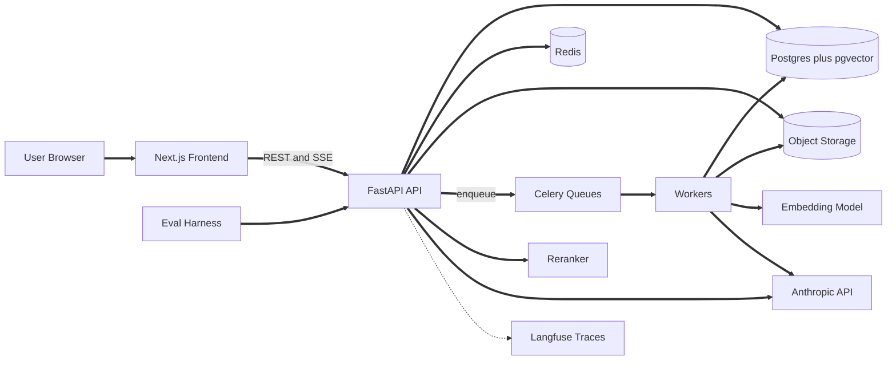
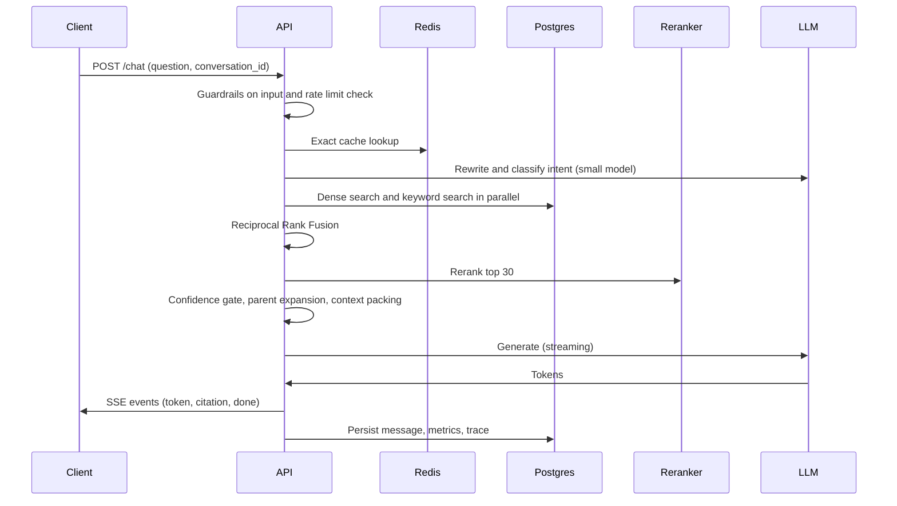

# ResearchPilot Architecture

This document is the source of truth for design decisions. If code and this file disagree, fix one of them in the same commit. Claude Code must read this before implementing any phase in CLAUDE.md.

## 1. Design Principles

1. **Everything swappable sits behind an interface.** Embedder, VectorStore, Reranker, Chunker, LLMClient. This is what makes the evaluation sweep possible.
2. **The pipeline is configuration, not code.** One `PipelineConfig` object (chunker, chunk size, retrieval mode, reranker, k values, prompt version, model) drives both production and the eval harness. Any experiment is a config diff.
3. **Retrieval quality is the product.** The LLM can only be as good as the context it receives. Spend engineering effort on ingestion and retrieval before prompt tweaking.
4. **Fail soft.** Every optional stage (rewrite, rerank, cache, tracing) has a fallback so the core answer path still works.
5. **Tenant isolation is enforced by the database, not by developer discipline.**
6. **Measure first.** No retrieval or prompt change merges without an eval run attached.

## 2. System Context



Runtime containers: frontend, api, worker (ingest queue), worker (llm queue), postgres, redis. Object storage is a local volume in dev and S3 compatible storage in production.

## 3. Ingestion Architecture

### 3.1 Job state machine

```
uploaded -> queued -> parsing -> chunking -> contextualizing -> embedding -> indexed -> ready
                         |          |              |               |
                         +----------+--------------+---------------+-> failed (with reason and retry count)
```

- Every transition is written to an `ingestion_jobs` table with timestamps. The frontend shows this status.
- Each stage is an idempotent Celery task keyed by `(document_version_id, stage)`. Re-running a stage deletes and rewrites only that stage's output.
- Retries use exponential backoff, max 3. After that the job goes to `failed` with a human readable reason. No silent dead letters.
- Dedupe: hash the file (SHA-256). If the same user already has that hash in `ready`, link to it instead of reprocessing.

### 3.2 Parsing

- Parse into a normalized intermediate form: a list of `Block` objects, each with `text`, `page`, `bbox` (x0, y0, x1, y1), `block_type` (heading, paragraph, table, list, code), and `heading_path` (for example `["3 Methods", "3.2 Data"]`).
- Bounding boxes are what make citation highlighting possible later. Store them at parse time, because recovering them afterward is painful.
- Scanned PDFs: detect pages with no extractable text and route to OCR (Tesseract via ocrmypdf) as an optional stage.
- Tables are kept as a single block rendered to Markdown so the LLM can read them.
- Web pages: trafilatura for main content, store the final URL and fetch time. Respect size limits and block private IP ranges (SSRF defense, see section 10).

### 3.3 Chunking: parent and child

Use small-to-big retrieval:
- **Child chunks** (about 200 to 300 tokens) are embedded and searched. Small chunks give precise matches.
- **Parent chunks** (about 800 to 1200 tokens, a section or several paragraphs) are what the LLM actually reads. Retrieval finds a child, then expands to its parent.
- Chunk boundaries respect `heading_path` and block types. Never split a table or code block.
- Each child stores `parent_id`, `page_start`, `page_end`, `bbox_list`, `heading_path`, and character offsets into the parent.
- Strategies behind one `Chunker` interface: `recursive`, `semantic` (split where embedding similarity between adjacent sentences drops), and `structure_aware` (default). The eval decides the default.

### 3.4 Contextual enrichment (optional stage, evaluate before enabling)

Before embedding, ask a cheap model (Haiku) to write one or two sentences situating each child chunk in the whole document, and prepend that text to the embedded and BM25 text only (not to what is shown to the user). This commonly reduces retrieval misses on chunks like "the company grew 3% over the previous quarter". It costs one LLM call per chunk, so use prompt caching on the document text and batch the calls. Gate it behind a config flag and report the cost and recall change in the eval.

### 3.5 Embedding

- Batch size 32 to 64 on CPU. Use a dedicated worker pool so embedding does not starve parsing.
- Store `embedding_model_id` on every chunk. Never mix models in one index.
- To switch models: create a new embedding column (or table) for the new model, backfill in the background, flip a config pointer, then drop the old one. This gives zero downtime re-indexing.
- Normalize vectors at write time so cosine similarity equals inner product.

## 4. Storage Design

### 4.1 Tables (additions to the CLAUDE.md model)

- `document_versions`: id, document_id, file_hash, version_no, status. Chunks belong to a version, so re-uploads never mix old and new content.
- `chunks`: id, version_id, user_id, parent_id (nullable), level (child or parent), content, context_prefix, page_start, page_end, bbox_list (jsonb), heading_path (text array), embedding (vector(384)), embedding_model_id, tsv (tsvector), token_count.
- `ingestion_jobs`: id, version_id, stage, status, attempts, error, started_at, finished_at.
- `query_logs`: id, message_id, config_hash, rewritten_query, retrieved_chunk_ids, scores (jsonb), cache_status, latency_breakdown (jsonb), tokens_in, tokens_out, cost_usd.
- `feedback`: id, message_id, rating, comment.
- `eval_runs` and `eval_results`: config_hash, git_sha, metrics (jsonb), per-question details.

### 4.2 Indexes and the filtered search problem

Every query is filtered by `user_id` and usually by a set of document ids. HNSW indexes apply filters after the graph search, so a selective filter can return fewer results than requested.

Mitigations, in order of preference:
1. Enable pgvector iterative index scans (`hnsw.iterative_scan`) so the search keeps scanning until enough rows pass the filter.
2. Raise `hnsw.ef_search` (start at 100) and measure recall against exact search on the eval set.
3. If a single user can have very large corpora, partition `chunks` by hash of `user_id` and index each partition.

Keep a test that compares HNSW results with exact (sequential scan) results for a few users and asserts recall of at least 0.95.

### 4.3 Row level security

```sql
ALTER TABLE chunks ENABLE ROW LEVEL SECURITY;
CREATE POLICY tenant_isolation ON chunks
  USING (user_id = current_setting('app.user_id')::uuid);
```

The API sets `app.user_id` at the start of every request transaction using `SET LOCAL`. The application DB role must not be a superuser and must not own the tables, otherwise RLS is bypassed. Add an integration test that tries to read another tenant's chunks with a crafted query and expects zero rows.

### 4.4 Capacity estimates

- One 384 dim float32 vector is 1,536 bytes. One million chunks is about 1.5 GB of vectors, plus roughly the same again for the HNSW index.
- A 300 page paper collection of 100 documents produces roughly 50k to 100k child chunks. A single Postgres instance handles this comfortably.
- Move to a dedicated vector database only when the measured p95 retrieval latency exceeds the budget in section 5.5 or the index no longer fits in memory.

## 5. Query Pipeline

### 5.1 Flow



### 5.2 Intent routing

A single cheap classification call (can be combined with query rewriting in one structured output) returns:
- `intent`: `qa`, `summarize`, `compare`, `quiz`, `chitchat`, `out_of_scope`
- `standalone_query`: the follow up rewritten to stand alone
- `target_documents`: optional explicit document references ("in the second paper")

Routing avoids running retrieval for greetings, and sends summarize and compare requests to dedicated strategies instead of forcing everything through top-k search.

### 5.3 Retrieval details

1. **Dense**: top 30 child chunks by cosine similarity.
2. **Sparse**: top 30 by Postgres full text rank (`ts_rank_cd`) or BM25. Keyword search rescues exact terms, names, and identifiers that embeddings blur.
3. **Fusion**: Reciprocal Rank Fusion with k=60. It needs no score calibration between the two lists.
4. **Rerank**: cross-encoder scores the top 30 fused candidates against the standalone query. Keep the top 6 or so.
5. **Diversify**: apply MMR or a simple cap of 3 chunks per parent so one section cannot crowd out everything else.
6. **Expand**: swap children for their parents, deduplicate, and order by document then page so the context reads naturally.
7. **Pack**: fill a token budget (for example 6,000 tokens) greedily by rerank score. Stop at the budget rather than at a fixed k.

### 5.4 Confidence gating

Use the top rerank score and the score gap, not raw cosine similarity, because cross-encoder scores are better separated. Calibrate the threshold on the eval set, including the unanswerable questions, by picking the value that maximizes refusal accuracy without hurting answer recall. Store the threshold in config. When gated out, the response says the documents do not cover the question and shows the closest passages the user can inspect.

### 5.5 Latency budget (target p50, first token under 2 seconds)

- Guardrails and cache lookup: 20 ms
- Rewrite and classify (small model): 300 to 500 ms
- Query embedding: 20 ms
- Dense plus sparse retrieval in parallel: 50 ms
- Rerank 30 candidates on CPU: 150 to 300 ms
- Prompt assembly: 10 ms
- Time to first token from the answer model: 600 to 900 ms

Skip the rewrite call for the first turn of a conversation, since there is nothing to resolve. Log each stage's duration in `query_logs.latency_breakdown` and chart it.

### 5.6 Generation and citations

- **Model tiering**: a small, fast model for rewrite, classification, and contextual enrichment. A stronger model for answers. Make both configurable.
- **Prompt layout for caching**: static system prompt first, then stable per-conversation material, then the retrieved context and question last. Mark the static prefix for Anthropic prompt caching so repeated calls pay less and start faster.
- **Context format**: each chunk is wrapped with an id the model must cite, for example `<source id="c_41" doc="Paper A" page="7">...</source>`. Context is explicitly labeled as untrusted data.
- **Citation strategy**: the model emits inline markers like `[c_41]`. A post-processor validates every marker against the packed context, drops invalid ones, and maps valid ones to `(document, page, bbox_list)` for the frontend. Consider the Anthropic native citations feature as an alternative and compare it in the eval.
- **Faithfulness check (optional, off by default)**: a second pass where a small model verifies that each sentence is supported by its cited chunk. Report the latency and cost tradeoff in the README.

### 5.7 Special modes

- **Summarize**: map-reduce. Summarize each section parent chunk independently (parallel calls), then combine. Cache section summaries per document version.
- **Compare**: run retrieval separately per document with the same standalone query, then give the LLM two labeled context blocks and ask for a structured comparison with citations per side.
- **Quiz and flashcards**: sample chunks across the document (stratified by section, not random), generate with a strict JSON schema, validate with Pydantic, retry once with the validation error appended, and store the source chunk id with every question.

## 6. Agent Layer

The agent is a bounded tool-use loop used only when the router marks a query as needing multiple steps or external tools. Plain Q and A never enters it.

- Tools: `search_documents(query, doc_ids)`, `calculator(expression)`, `fetch_url(url)`. All tool inputs are validated and all outputs are treated as untrusted data.
- Hard limits: 5 iterations, a total token budget, and a wall clock timeout. On exceeding any limit, return the best answer so far and say so.
- `fetch_url` runs through the SSRF filter, has a size cap, and strips scripts.
- The calculator uses a safe expression parser (for example `asteval` or an AST whitelist), never `eval`.
- Every tool call is a span in the trace with its input, output size, and duration.

## 7. Caching Layers

1. **Prompt cache** (Anthropic): static prefix. Free correctness, pure latency and cost win.
2. **Embedding cache** (Redis): key is hash of text plus model id. Helps repeated queries and re-ingestion.
3. **Exact response cache** (Redis): key is hash of `(user_id, document_set_version_hash, standalone_query, config_hash)`. Short TTL.
4. **Semantic cache**: store the query embedding with the answer. Serve a hit only if similarity is at least 0.95 and `user_id`, document set version hash, and config hash all match.

Correctness rules for caches:
- Include a document set version hash in every key, so adding, deleting, or re-uploading a document invalidates stale answers automatically.
- Never share cache entries across users.
- Do not cache answers produced by the agent when tools hit external URLs.
- Record `cache_status` (miss, exact, semantic, prompt_cached) on every message so hit rates show in the dashboard.
- Evaluate the semantic cache for wrong answers: add eval pairs of near-duplicate questions with different correct answers and verify no false hits.

## 8. Streaming Protocol

Server-Sent Events with typed events:
- `meta`: message id, config hash, cache status
- `status`: stage updates such as "searching", "reranking", "writing"
- `token`: text delta
- `citation`: resolved citation object (can arrive after the sentence that uses it)
- `tool`: tool call started or finished (agent mode)
- `done`: final usage, latency, cost
- `error`: code and safe message

Details that matter:
- Send a heartbeat comment every 15 seconds to keep proxies from closing the connection.
- Persist the assistant message when the stream completes, and persist partial text if the client disconnects, marked `incomplete`.
- Support `Last-Event-ID` for reconnect where practical, otherwise let the client fetch the saved message by id.
- Disable response buffering in any reverse proxy (`X-Accel-Buffering: no`).
- Use the SDK's streaming interface and forward deltas without accumulating them in memory twice.

## 9. Async Work and Rate Limits

- Separate Celery queues: `ingest` (parse and chunk, CPU), `embed` (CPU or GPU), `llm` (network bound, used for enrichment and summaries). Different concurrency per queue.
- Wrap all Anthropic calls in one `LLMClient` with: retry with jitter on 429 and 5xx, a timeout, a concurrency semaphore, and a Redis token bucket so the worker fleet and API share one rate limit budget.
- Use the outbox pattern for enqueueing: write the job row and the "to enqueue" intent in one DB transaction, and a small dispatcher publishes to Celery. This prevents the case where the file is saved but the job is lost.
- Per-user quotas: daily token budget and upload size limit, enforced in Redis, returned as clear 429 responses.

## 10. Security Architecture

Defense in depth against prompt injection (no single layer is trusted):
1. **Input**: detect common injection patterns in uploaded text at ingestion and flag the chunk. Flagged chunks are still retrievable but are wrapped with an extra warning in the prompt.
2. **Prompt structure**: system instructions state that anything inside `<source>` tags is data. Never place document text in the system role.
3. **Capability limits**: the model has no write tools. Tools that fetch URLs cannot reach private networks.
4. **Output**: citation validation, and strip markdown images and links to unknown domains from answers (prevents data exfiltration through image URLs).
5. **Tests**: a fixture set of malicious documents (hidden instructions, fake system messages, exfiltration attempts) run in CI. The test passes only if the answer ignores the injected instruction.

Other controls:
- SSRF protection for URL ingestion: resolve DNS, reject private, loopback, and link-local addresses, re-check after redirects, enforce size and time limits.
- Uploads: verify magic bytes not just extensions, cap size and page count, scan with a size-limited parser inside the worker only (never in the API process), store with random names outside any served directory, serve through authenticated endpoints or short-lived signed URLs.
- Auth: short-lived access tokens, refresh tokens in HttpOnly cookies, argon2 password hashing, login rate limiting.
- Secrets only through environment variables. Redact keys and document text from logs and traces. PII masking runs before data is sent to the tracing backend.

## 11. Observability

- One trace per request, with spans for: guardrails, cache lookup, rewrite, dense search, sparse search, fusion, rerank, packing, generation, citation validation.
- Metrics (Prometheus style or just SQL over `query_logs`): p50 and p95 latency per stage, tokens in and out, cost per query, cache hit rate by layer, refusal rate, ingestion duration per page, queue depth, error rate by type.
- Cost accounting: compute from usage returned by the API and a price table in config. Show cost per conversation and per user.
- Online quality signals: thumbs up or down, and a sampled LLM-as-judge faithfulness score on a small percentage of live answers, to catch drift.
- Alerts worth having: p95 latency above budget, refusal rate spike, ingestion failure rate, daily cost above threshold.

## 12. Evaluation Architecture

- `PipelineConfig` is hashed. Every eval run stores `config_hash`, git SHA, dataset version, and per-question results, so any two runs are comparable.
- The harness calls the same service layer as the API (not HTTP), with the LLM and embedder real or recorded.
- Datasets:
  - **Golden set**: 30 to 50 hand verified Q and A pairs with source pages. Includes factual, multi hop, table, comparison, and unanswerable questions.
  - **Synthetic set**: LLM generated questions per chunk, filtered for quality, used for broad retrieval recall. Never use it as the only measure.
  - **Adversarial set**: injection documents and near-duplicate questions for the cache.
- Metrics:
  - Retrieval: recall@5, recall@10, MRR, and page hit rate
  - Generation: faithfulness, answer correctness against reference, citation precision (cited chunk really supports the claim)
  - Behavior: refusal accuracy, false refusal rate
  - Systems: latency by stage, cost per query
- Judges: use a stronger or different model than the one being evaluated where possible, with a fixed rubric prompt and temperature 0. Spot check 10 percent of judge outputs by hand and record agreement.
- Sweeps: a script takes a grid (chunk size x retrieval mode x reranker x enrichment on or off) and writes a results table. Publish it in `docs/eval_results.md`.
- CI runs a 10 question smoke subset with a recorded LLM so it is fast and free, and fails if recall drops more than a set margin.

## 13. Failure Modes and Degradation

- **LLM API down or rate limited**: retry, then return a clear error with the retrieved passages so the user still gets value.
- **Reranker fails or times out**: fall back to fused ranking, mark `degraded` in the trace.
- **Rewrite call fails**: use the raw question plus the last user turn.
- **Redis down**: bypass caches and rate limiting falls back to a conservative in-process limit. The API stays up.
- **Embedding model mismatch** (query embedder differs from index): the API refuses to start if `embedding_model_id` in config does not match the active index.
- **Partial ingestion**: documents are only queryable when all stages complete, so users never get answers from half-indexed files.
- **Document deleted during a conversation**: citations to it render as "source removed" rather than erroring.

## 14. Interfaces (contract for implementation)

```python
class Embedder(Protocol):
    model_id: str
    dim: int
    def embed_documents(self, texts: list[str]) -> list[list[float]]: ...
    def embed_query(self, text: str) -> list[float]: ...

class VectorStore(Protocol):
    def upsert(self, chunks: list[ChunkRecord]) -> None: ...
    def search(self, vector: list[float], k: int, scope: Scope) -> list[Hit]: ...
    def delete_version(self, version_id: UUID) -> None: ...

class KeywordIndex(Protocol):
    def search(self, query: str, k: int, scope: Scope) -> list[Hit]: ...

class Reranker(Protocol):
    def rerank(self, query: str, hits: list[Hit], top_n: int) -> list[Hit]: ...

class Chunker(Protocol):
    def chunk(self, blocks: list[Block]) -> list[ChunkDraft]: ...

class LLMClient(Protocol):
    async def complete(self, req: LLMRequest) -> LLMResponse: ...
    async def stream(self, req: LLMRequest) -> AsyncIterator[LLMEvent]: ...
```

`Scope` always carries `user_id` and optional `document_ids`, so it is impossible to call a store without a tenant.

## 15. Architecture Decision Records (summary)

1. **Postgres with pgvector instead of a separate vector DB.** One system to operate, transactional consistency between metadata and vectors, SQL filters, RLS. Revisit if scale demands it.
2. **Hybrid search with RRF plus cross-encoder rerank.** Best known quality per complexity. Measured in the eval, not assumed.
3. **Parent and child chunks.** Precise matching with enough context for the LLM.
4. **Config driven pipeline.** Makes evaluation sweeps trivial and keeps experiments reproducible.
5. **Citations validated server side.** The model proposes, the server verifies.
6. **SSE over WebSockets.** One direction streaming, simpler infrastructure, works through standard proxies.
7. **Celery with an outbox.** Reliable ingestion without adding a heavyweight workflow engine. Revisit Temporal only if multi step durable workflows grow.
8. **Local embeddings by default.** Zero marginal cost and no document text leaves the machine for embedding. Adapter allows hosted models for comparison.
9. **Model tiering.** Cheap model for control tasks, stronger model for answers, both configurable and measured.
10. **Semantic cache scoped by document set version.** Avoids stale answers, which are the main risk of semantic caching.

## 16. Open Risks to Watch

- Layout heavy PDFs (multi column, tables, formulas) can degrade parsing and therefore everything downstream. Include such documents in the golden set early.
- Cross-encoder reranking on CPU may dominate latency. Measure, then consider a smaller model, fewer candidates, or an API reranker.
- LLM judge bias and variance can mislead evaluation. Keep the human spot check.
- Contextual enrichment can be expensive for large documents. Gate by document size and show the cost before enabling.
- Semantic cache false hits. Keep the threshold conservative and track a false hit metric.
